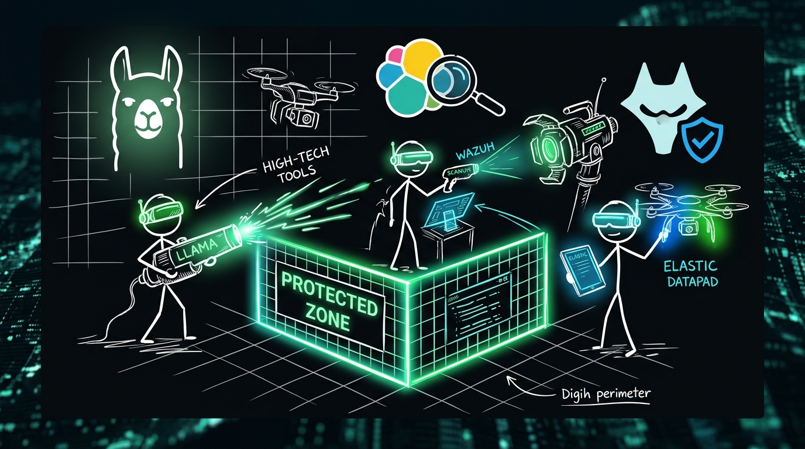

Small security teams often feel like they're fighting a losing battle against massive, well-funded adversaries. When you're responsible for dozens, hundreds, or even thousands of endpoints with only a handful of analysts, the sheer volume of telemetry can be overwhelming. It's easy to feel like you're just "putting out fires" rather than actually defending your organization.

But what if you had a force multiplier? What if you could deploy enterprise-grade AI capabilities without the enterprise-grade price tag?

In this post, we’re going to look at how small teams are using the power of open-source AI to punch way above their weight class, drawing from real-world case studies.

### The Power of Context: Elastic SIEM + OpenCTI

In one case study involving a fast-growing FinTech startup, the team was drowning in alerts. They had the tools, but they didn't have the *eyes*. They were struggling to separate the signal from the noise, leading to a dangerous backlog of uninvestigated incidents.

By integrating **Elastic SIEM** with **OpenCTI**, they didn't just get more data—they got more *meaning*. They used **Llama-2** to automatically summarize and categorize incoming logs, turning cryptic error messages into human-readable intelligence.

**The result?** Their Mean Time to Containment (MTTC) plummeted from 4 hours to just 45 minutes, and their false-positive rate dropped by 60%. They weren't just working harder; they were working smarter.

### Detecting the Invisible: Wazuh + FAISS

Another team—a regional healthcare provider—faced a different challenge. They were worried about "living-off-the-land" attacks: those subtle, stealthy movements where an attacker uses legitimate system tools to stay under the radar. Traditional signature-based detection was practically blind to this.

Their solution? They combined **Wazuh** for deep endpoint visibility with **FAISS** for vector-based similarity searches. By turning process execution logs into mathematical embeddings, they could spot anomalies that looked "slightly off" compared to historical norms.

This allowed them to detect lateral movement that would have otherwise gone unnoticed, providing the deep visibility they needed to maintain HIPAA compliance without a massive increase in headcount.

### The AI Arsenal: A Multi-Layered Approach

The common thread across these successes isn't just "using AI"—it's using the *right kind* of AI for the right task.

- **LLMs (like Llama-2 or Mistral):** Perfect for the "language" of security—summarizing logs, extracting IOCs, and explaining alerts in plain English.
- **Vector Databases (like FAISS):** The key to finding "things that look similar"—detecting anomalies by comparing new behavior to known-good or known-bad patterns.
- **Reinforcement Learning (RL):** The future of response—training agents to suggest the best course of action (like blocking an IP or isolating a host) based on the specific context of an incident.

### The Bottom Line

AI isn't a magic wand that replaces the need for skilled analysts. Instead, it acts as the ultimate force multiplier. By automating the "drudgery"—the log parsing, the initial triage, the routine enrichment—AI frees up your human experts to do what they do best: high-level decision-making, threat hunting, and strategic defense.

For small teams, the message is clear: the tools are available, the community is active, and the playing field is finally starting to level.

***

**Analogy for Understanding:**

Think of it like a small neighborhood watch that suddenly gains access to a fleet of high-tech drones and an automated dispatch system. You might not have a thousand officers patrolling every street, but with drones that can spot trouble from miles away and an automated system that can lock doors the moment a window is broken, you can protect your community just as effectively as a much larger force.

***
