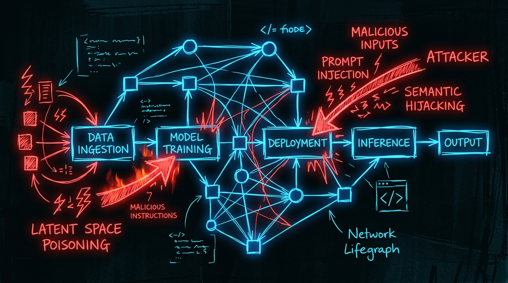

# Beyond the Prompt: Integrating CrowdStrike’s 2026 AI Threat Patterns into Modern Security Frameworks

The landscape of Artificial Intelligence security shifted dramatically this month. In July 2026, CrowdStrike released a landmark research paper detailing five specific exploitation patterns that are moving beyond simple prompt injection into sophisticated, systemic attacks. 

For security practitioners, the challenge is no longer just "securing the chatbot." It is about securing the entire AI lifecycle—from training data to autonomous agent execution. This post provides a detailed analysis of these patterns, maps them to the industry's most critical frameworks, and provides a roadmap for integrating these findings into a modern **AI Vulnerability Management Lifecycle**.

---

## The Five Critical AI Attack Patterns (CrowdStrike July 2026)

CrowdStrike's research highlights a move toward *latent* and *agentic* attacks that bypass traditional text-based filters.

### 1. Semantic Hijacking (Contextual Indirect Injection)
Attackers no longer need to speak directly to the model. Instead, they embed malicious instructions within data sources the AI is designed to ingest (e.g., a PDF, a webpage, or an email). When the model retrieves this "poisoned" context to answer a user's query, the instructions are executed, leading to unauthorized data access or tool use.

### 2. Latent Space Poisoning
This pattern targets the fundamental weights of the model. By injecting specifically crafted training samples or fine-tuning data, attackers can create "backdoors" in the model's latent space. These backdoors remain dormant until a specific, seemingly innocuous trigger is provided, at which point the model exhibits biased, incorrect, or malicious behavior.

### 3. Agentic Privilege Escalation
As we move from passive LLMs to autonomous AI Agents, the attack surface has expanded. In this pattern, an attacker uses a low-privilege prompt to trick an agent into executing high-privilege system commands or accessing sensitive API endpoints, effectively hijacking the agent's ability to interact with the physical or digital world.

### 4. Multimodal Exfiltration
Traditional Data Loss Prevention (DLP) focuses on text. CrowdStrike identified a surge in attackers using multimodal models to exfiltrate data through non-textual channels—such as encoded patterns in generated images or subtle frequency modulations in synthesized audio—effectively bypassing standard text-based monitoring.

### 5. Automated Adversarial Drift
Unlike a single "jailbreak," this is a slow-burn attack. Attackers use automated feedback loops to subtly influence a model's behavior over time through continuous, minor user interactions. This "drift" gradually degrades the model's safety guardrails or biases it toward specific outputs without triggering immediate anomaly alerts.

---

## Framework Mapping: Aligning Threats to Governance

To defend against these patterns, organizations must align their security controls with established frameworks.

| Pattern | OWASP AI Top 10 | MITRE ATLAS | NIST AI RMF | ISO 42001 |
| :--- | :--- | :--- | :--- | :--- |
| **Semantic Hijacking** | AI01: Prompt Injection | AML.T0001 | Manage Risk (Context) | Data Governance |
| **Latent Space Poisoning** | AI03: Training Data Poisoning | AML.T0012 | Model Integrity | Lifecycle Management |
| **Agentic Escalation** | AI07: Insecure Output Handling | AML.T0026 | System Robustness | Access Control |
| **Multimodal Exfiltration** | AI06: Model Evasion | AML.T0015 | Privacy & Security | Data Protection |
| **Adversarial Drift** | AI05: Model Manipulation | AML.T0011 | Continuous Monitoring | Quality Management |

---

## Roadmap: The AI Vulnerability Management Lifecycle

Integrating these findings requires moving from a reactive stance to a proactive, lifecycle-based approach.

### Phase 1: Identification & Asset Inventory
You cannot secure what you cannot see.
* **Action:** Catalog all LLM instances, fine-tuned models, vector databases, and autonomous agents.
* **Focus:** Map data flows between users, models, and third-party tools to identify potential "Semantic Hijacking" points.

### Phase 2: Advanced Adversarial Red Teaming
Traditional penetration testing is insufficient for AI.
* **Action:** Implement **Agentic Red Teaming**. Use specialized AI agents to simulate multi-step attacks, such as attempting to escalate privileges or trigger latent backdoors.
* **Focus:** Test for "Latent Space Poisoning" by simulating adversarial training scenarios.

### Phase 3: Guardrail Engineering (Preventative Controls)
Defense-in-depth must be built into the model's architecture.
* **Action:** Implement **Semantic Firewalls**. Instead of simple keyword filtering, use small, high-speed models to analyze the *intent* of both inputs and outputs.
* **Focus:** Deploy "Output Sanitization" to prevent "Agentic Privilege Escalation" and "Multimodal Exfiltration."

### Phase 4: Real-time Detection & Response (Detective Controls)
Detection must move at the speed of the model.
* **Action:** Monitor for **Semantic Drift** and **Token Entropy**. Sudden changes in the statistical distribution of model outputs can indicate a "Slow-Burn" attack or model manipulation.
* **Focus:** Integrate AI security signals into your existing SIEM/SOAR workflows to enable real-time response to anomalous agent behavior.

---

## Conclusion

The July 2026 CrowdStrike findings serve as a wake-up call. The era of treating AI as a "black box" is over. To build resilient AI systems, security teams must embrace a lifecycle-centric approach—one that combines rigorous framework alignment with cutting-edge red teaming and real-time semantic monitoring.

*Stay tuned to our blog for more deep dives into the evolving world of AI security.*
